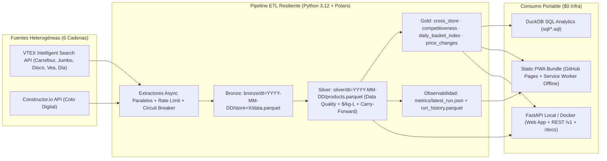

# 🛒 ChangoRadar — ETL Medallion, Analítica SQL (DuckDB) y Comparador de Precios AR

[](https://www.python.org/)
[](https://pola.rs/)
[](https://duckdb.org/)
[](https://fastapi.tiangolo.com/)
[](./terraform/)
[](./LICENSE)

Pipeline **ETL Medallion Lakehouse**, capa analítica **SQL con DuckDB sobre Parquet**, tablero de **Observabilidad / Data Quality** y **Web App / PWA liviana** para comparar precios en **6 cadenas de supermercados de Argentina** (**Carrefour, Coto, Dia, Jumbo, Disco y Vea**).

Diseñado con dos objetivos claros:
1. **Uso real diario para familias y amigos:** buscar precios en milisegundos desde el celular, comparar `$/kg` y `$/L` (anti-reduflación), armar el changuito semanal optimizado (compra única vs. compra partida + envío a WhatsApp) y detectar falsas promociones (*caza-bobos*) en la góndola — **sin logins, sin servidores pagos y con soporte offline (PWA)**.
2. **Ingeniería de Datos y BI sin sobreingeniería:** extracción asíncrona multi-API, arquitectura **Bronze → Silver → Gold** particionada tipo Hive en Parquet ZSTD, **Data Quality Gates** auditables, consultas **SQL portables con CTEs y Window Functions**, CI/CD con GitHub Actions e infraestructura opcional declarada en **Terraform**.

---

## Arquitectura End-to-End



### Decisiones de Ingeniería y Tradeoffs

| Decisión | Alternativa descartada | Por qué se eligió esta opción |
| :--- | :--- | :--- |
| **Polars + Parquet ZSTD (Hive)** | Spark / Postgres / BigQuery | Procesa decenas de miles de SKUs en `<100ms` con memoria mínima, compresión columnar >75% y cero bases de datos que mantener o pagar. |
| **DuckDB embebido (`sql/*.sql`)** | Warehouse pago | Ejecuta SQL analítico estándar (CTEs, `LAG`, `MEDIAN`, `ROW_NUMBER`) directamente sobre los archivos Parquet locales en milisegundos. |
| **PWA Vanilla HTML/CSS/JS + JSON estático** | React/Next.js + backend siempre encendido | Cero *build step*, cero CDNs externos, funciona offline dentro del supermercado y se aloja gratis en **GitHub Pages** (`$0`). Si el cron de scraping falla un día, la app sigue 100% online. |
| **Aislamiento por tienda + Carry-Forward** | Corrida todo-o-nada | Cada cadena corre en paralelo con su propio *circuit breaker* (corta tras 3 errores `403/5xx`). Si un súper cae hoy, se conservan sus últimos precios válidos (hasta 7 días) marcando explícitamente la frescura. |
| **Exclusiones personales en cliente (`localStorage`)** | Blacklist personal en el ETL | Silver conserva el catálogo comercial completo (solo aplica reglas técnicas de calidad); cada persona puede ocultar rubros opcionalmente en su propio navegador sin afectar al resto. |

---

## Quickstart en 2 Comandos (Modo Demo Offline)

El repositorio incluye un Lakehouse de ejemplo (`data/demo/`, 3 días multi-tienda) para probar todo el stack analítico y la Web App **sin depender de APIs externas**:

```bash
# 1. Instalar dependencias con uv (Python 3.12+)
uv sync --dev

# 2. Ver el reporte ejecutivo SQL (DuckDB) + Data Quality en terminal
uv run scraper report --demo

# 3. Levantar la Web App (Comparador + Changuito + Promos + Dashboard BI)
uv run scraper serve --demo
```

Abrí `http://localhost:8001` en tu navegador (o `http://localhost:8001/docs` para Swagger OpenAPI).

---

## Extracción Real y Uso Diario

```bash
# Comprobar salud y latencia en vivo de las 6 APIs
uv run scraper stores

# Extraer canasta extendida en paralelo (6 cadenas) + generar Gold + bundle PWA
uv run scraper extract --stores all --basket extended --pages 2 --export-web

# Extraer catálogo completo por árbol de categorías FMCG (consumo masivo)
uv run scraper extract --stores all --fmcg --pages 2 --export-web

# Ejecutar una consulta SQL específica sobre tu Lakehouse Parquet
uv run scraper query sql/03_cazabobos_audit.sql

# Exportar snapshot estático a web/data/ (listo para abrir o publicar en GitHub Pages)
uv run scraper export-web
```

> **Plan B anti-bloqueo de IP:** si un runner cloud (GitHub Actions / GCP) recibe bloqueo WAF de algún supermercado, `./scripts/refresh_local.sh` ejecuta el mismo pipeline desde tu red residencial en un solo comando.

---

## Qué incluye la Web App / PWA (`web/`)

1. **🔍 Comparador Multi-Súper:** búsqueda instantánea (<10ms sin acentos), precios de las 6 cadenas lado a lado con corona `👑 Mejor`, precio estandarizado `$/kg` y `$/L`, brecha de ahorro y link directo a cada tienda.
2. **🛒 Mi Changuito:** lista de compras persistente en el navegador que calcula **Mejor compra en 1 solo súper** vs. **Compra partida óptima** y arma un resumen listo para copiar y pegar en **WhatsApp**.
3. **⚡ ¿Es Promo o Cazabobos? (+ Comercio de Barrio):** calcula el precio unitario efectivo de promociones argentinas (`2do al 70%`, `3x2`, `4x3`, `% off` + reintegro bancario/billetera) frente a precios reales del mercado, y compara compras de verdulería/carnicería/almacén contra los súper.
4. **⭐ Favoritos y Mis Filtros:** seguimiento de productos habituales con badges de variación semanal, importar/exportar lista JSON entre familiares y filtros personales opt-in (100% en `localStorage`).
5. **📊 Dashboard BI & Data Quality:** gráficos en **SVG nativo** (sin CDNs) de competitividad (*win-rate* e índice vs. mediana), curva de inflación de canasta, mayores subas/bajas, auditoría automática de *caza-bobos*, oportunidades de stockeo y tablero de salud del pipeline Medallion.

---

## Capa Analítica SQL (DuckDB sobre Parquet)

Todas las consultas en [`sql/`](./sql/) corren sin levantar ningún servidor sobre los Parquet particionados:

| Consulta | Técnicas SQL | Pregunta de Negocio |
| :--- | :--- | :--- |
| [`sql/01_basket_inflation.sql`](./sql/01_basket_inflation.sql) | CTEs, `LAG()`, `FIRST_VALUE()` | ¿Cuánto subió la canasta básica día a día por cadena vs. compra partida? |
| [`sql/02_store_competitiveness.sql`](./sql/02_store_competitiveness.sql) | `MEDIAN()`, `LEFT JOIN`, agregación multi-nivel | ¿Qué supermercado gana más veces en EANs compartidos y cuál es su índice de precios vs. la mediana (base 100)? |
| [`sql/03_cazabobos_audit.sql`](./sql/03_cazabobos_audit.sql) | `ARG_MIN()`, anti-join cross-store | ¿Qué productos anunciados en oferta siguen siendo >5% más caros que el precio regular de un competidor? |
| [`sql/04_unit_price_leaders.sql`](./sql/04_unit_price_leaders.sql) | `ROW_NUMBER() OVER (PARTITION BY ...)` | ¿Cuáles son las 3 opciones más baratas por kilo o litro (`$/kg`, `$/L`) en cada rubro? |

---

## Automatización, CI/CD e IaC (Terraform)

- **CI (`.github/workflows/ci.yml`):** en cada push/PR ejecuta `ruff check`, `pytest`, smoke test de las 4 queries DuckDB SQL, export estático PWA y `terraform fmt -check`.
- **Cron Diario + GitHub Pages (`.github/workflows/daily-etl.yml`):** corre todos los días a las **06:00 AM ART**, restaura snapshots Silver históricos desde `actions/cache` (habilitando *Carry-Forward* y curvas de inflación en `$0`) y publica la PWA actualizada en GitHub Pages.
- **Infraestructura como Código (`terraform/`):** módulo Terraform opcional y parametrizado para desplegar en **Google Cloud Platform** (Cloud Storage Lakehouse con lifecycle de 365 días, Cloud Run Job, Cloud Scheduler e IAM de mínimo privilegio). Ver [`docs/architecture.md`](./docs/architecture.md).

---

## Tests y Calidad de Código

```bash
uv run ruff check src tests scripts
uv run pytest -v
```

---

## Documentación Técnica

- [`docs/architecture.md`](./docs/architecture.md) — Detalle de arquitectura ETL, resiliencia, despliegue en GitHub Pages y GCP/Terraform.
- [`docs/data_model.md`](./docs/data_model.md) — Esquemas de capas Bronze, Silver y Gold, reglas de Data Quality y métricas de observabilidad.
